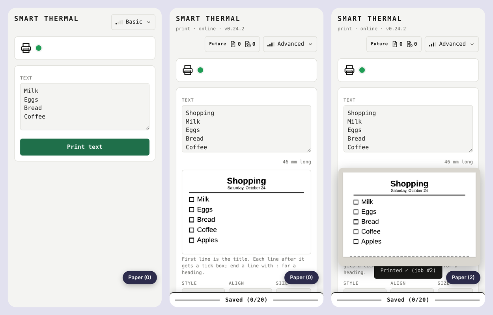

# Smart Thermal

An ESP32 controller that turns a networked 80 mm receipt printer into a
**shared list printer**. Its job is to quickly print clear physical lists from any phone or
computer on the Wi-Fi, with no app and no account.

- **Type and print.** A web page served by the ESP32 itself. It starts simple (Basic), and
  every device can choose more: Standard, Advanced or Expert.
- **Photos and pictures.** Dithered in the browser and printed in parts if long.
- **Styles.** List, note, love note, and a joke "Parking fine". "From image" copies the text
  of a screenshot as pixels, so nothing is misread.
- **Drafts, saved lists and scheduled prints.** Kept on the unit and shared by every device.
  Schedules run on the unit, even when no phone is open.
- **Online printing (optional).** The unit dials out to a small relay (`relay/`) so it can be
  used from anywhere, without router setup. Each printer is approved by the relay's owner,
  and per-device approval is available.
- **Setup from paper.** A new unit prints a slip with a QR code to its own setup hotspot.
- **Party kiosk.** A full-screen page for events.

[](https://justifiedsystems.com.au/lab/smart-thermal/demo/)

**[▶ Try the live demo](https://justifiedsystems.com.au/lab/smart-thermal/demo/)**: the real
page running against a pretend printer, in your browser. Nothing is printed, and no hardware
is needed.

## Repository

| Folder | What | Goes where |
|---|---|---|
| `SmartThermal/` | The Arduino sketch: firmware and the web page (`WebUI*.h`) | Flashed to the ESP32 |
| `SmartThermal/tools/` | `build_pages.js` builds `dist/preview.html` and `dist/demo.html` from the page source; `fakeunit.js` is the pretend printer | Your PC only (Arduino ignores it) |
| `relay/` | The Cloudflare Worker for online printing | Cloudflare (`npx wrangler deploy`) |
| `tests/` | Page tests (headless Chrome), PC harnesses for the scheduler and the relay link | Your PC only |
| `docs/` | Handover notes, relay protocol, demo hosting | Reading |

## Hardware

| Part | Used here |
|---|---|
| Controller | ESP32-WROOM-32 (4 MB flash, no PSRAM) |
| Printer link | W5500 Ethernet module over SPI (CS 5, RST 4, SCK 18, MISO 19, MOSI 23), cabled straight to the printer |
| Printer | POS-8370 (80 mm, 576 dots, ESC/POS on port 9100). Most generic 80 mm network printers should work. |

## Build and flash

1. Install the Arduino IDE 2 with the **esp32** boards package (3.3.x), and the libraries
   **ArduinoJson** (7.x) and **Ethernet** (2.x).
2. Open `SmartThermal/SmartThermal.ino`.
3. Board: **ESP32 Dev Module**. Partition scheme: **Huge APP (3MB No OTA/1MB SPIFFS)**. The
   firmware is about 1.6 MB, which does not fit the default scheme. If a `partitions.csv` is in
   the sketch folder, the IDE uses it instead.
4. Leave **Erase All Flash Before Sketch Upload** disabled. Settings, saved lists and the unit's
   identity live in flash.
5. Upload. On first start the printer prints a setup slip. Scan it, choose your Wi-Fi, and a
   welcome slip with the page's address follows.

## Preview before flashing

```
node SmartThermal/tools/build_pages.js
```

This writes `dist/preview.html` (double-click it, then switch between Home and Online view)
and `dist/demo.html` (the public demo). Both are the real page with a pretend printer:
nothing is sent anywhere, and printouts appear on virtual paper. The demo build leaves out
everything marked home-only (Settings, online set-up, kiosk set-up), and refuses to build if
any address, link or code would remain.

## Online printing relay

`relay/` is a single-file Cloudflare Worker with one Durable Object. See `relay/README.md` for
set-up, secrets and go-live checks, and `docs/PROTOCOL.md` for the protocol. Without a relay,
the printer works on its own network as normal.

## Security

See [SECURITY.md](SECURITY.md) for the security model, what is and is not protected, and how
to report a problem.

## Licence

MIT. See [LICENSE](LICENSE).
